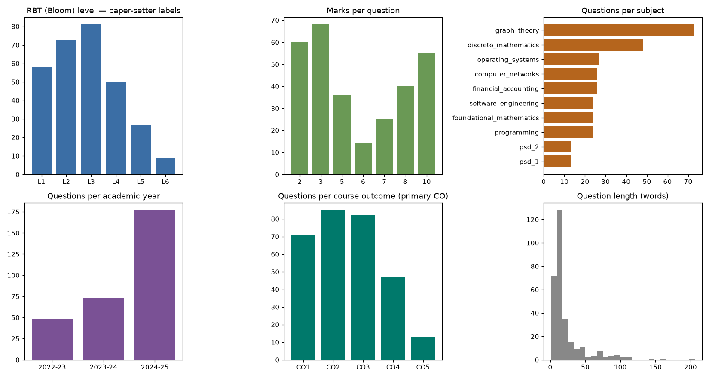
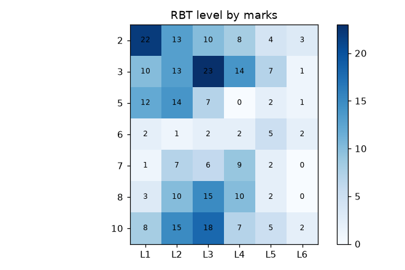

# Dataset Analysis

Generated by `scripts/analyze_dataset.py` from `data/processed/` — every number below is computed, none is estimated.

## 1. Inventory

| Metric | Value |
|---|---|
| Papers admitted (parser-verified) | 13 |
| …supplied by the project owner (`Question Papers/`) | 11 |
| …from the public university data bank, downloaded earlier in this project | 2 |
| Questions extracted (each OR-alternative / sub-part counted) | 298 |
| Subjects (families) | 10 |
| Academic years | 2022-23, 2023-24, 2024-25 |
| Files rejected by the verification gate | 46 |
| Files collapsed as duplicates (identical bytes / same exam re-uploaded) | 21 |

### Rejection reasons (nothing is dropped silently)

- 34 × no questions parsed (unsupported legacy layout or scanned)
- 12 × verification failed

The 34 'no questions parsed' files are older (2015–2022) papers in a different, label-free layout (no CO/RBT columns); they are not usable as labelled data and OCR is unavailable (no Tesseract binary), so they are excluded rather than guessed at.

## 2. Extraction quality

Verified against the paper itself, not against a gold annotation: item counts per section, marks per section and the paper's Max Marks must reconcile, and every question must carry marks + CO + RBT. All 13 admitted papers pass. Remaining blemishes: 9 questions have < 5 words (math/formula text lost in PDF extraction — formulas rendered as images or private glyphs), 4 carry two RBT labels (first used).

## 3. Distributions

| Level | Questions | Share |
|---|---|---|
| L1 | 58 | 19.5% |
| L2 | 73 | 24.5% |
| L3 | 81 | 27.2% |
| L4 | 50 | 16.8% |
| L5 | 27 | 9.1% |
| L6 | 9 | 3.0% |

| Marks | Questions |
|---|---|
| 2 | 60 |
| 3 | 68 |
| 5 | 36 |
| 6 | 14 |
| 7 | 25 |
| 8 | 40 |
| 10 | 55 |

| Subject | Papers | Questions |
|---|---|---|
| graph_theory | 3 | 73 |
| discrete_mathematics | 2 | 48 |
| operating_systems | 1 | 27 |
| computer_networks | 1 | 26 |
| financial_accounting | 1 | 26 |
| software_engineering | 1 | 24 |
| foundational_mathematics | 1 | 24 |
| programming | 1 | 24 |
| psd_2 | 1 | 13 |
| psd_1 | 1 | 13 |

Question kinds: {'single': 184, 'alt': 112, 'part': 2}.
Words per question: mean 22.5, median 14, min 1, max 206.

## 4. Duplicates and repetition

Across different papers: 1 exact and 7 near-duplicate question pairs (cosine ≥ 0.90 or word-3-gram Jaccard ≥ 0.6); 15 questions (5.0%) take part in at least one pair; 8 of those pairs are within the same subject (questions re-asked in another year). This is why the evaluation protocols never split a subject across train/test (leave-one-subject-out) or remove near-duplicates (leave-one-paper-out).

## 5. Source-question quality status

Original text is never altered; status decides eligibility for exemplars/training. `ILL_POSED`/`AMBIGUOUS` are reserved for human adjudication and never assigned automatically. The LLM screen can only raise `NEEDS_HUMAN_REVIEW` and is **uncalibrated** (no human review exists).

- deterministic checks only: {'VALID': 277, 'INCOMPLETE': 11, 'EXTRACTION_ERROR': 10} (7.0% defective)
- with LLM screen: {'VALID': 172, 'NEEDS_HUMAN_REVIEW': 105, 'INCOMPLETE': 11, 'EXTRACTION_ERROR': 10}

| course | n | VALID | NEEDS_HUMAN_REVIEW | INCOMPLETE | EXTRACTION_ERROR |
|---|---|---|---|---|---|
| computer_networks | 26 | 18 | 8 | 0 | 0 |
| discrete_mathematics | 48 | 21 | 22 | 1 | 4 |
| financial_accounting | 26 | 16 | 10 | 0 | 0 |
| foundational_mathematics | 24 | 16 | 6 | 0 | 2 |
| graph_theory | 73 | 44 | 16 | 10 | 3 |
| operating_systems | 27 | 13 | 14 | 0 | 0 |
| programming | 24 | 18 | 5 | 0 | 1 |
| psd_1 | 13 | 7 | 6 | 0 | 0 |
| psd_2 | 13 | 3 | 10 | 0 | 0 |
| software_engineering | 24 | 16 | 8 | 0 | 0 |

## 6. Limitations (read before trusting any model number)

- **Small**: 298 questions / 13 papers; L6 has 9 examples, L5 27.
- **One programme** (BCA), ten courses, 2022–2025; some subjects have a single paper, so same-course temporal generalisation can only be tested on graph theory (3 papers) and discrete mathematics (2); PSD-I→PSD-II is only a related-course transfer case.
- **Labels are teacher assertions, not ground truth**: the RBT level beside each question is the paper setter's judgement. The label audit (docs/EVALUATION_BLOOM.md) shows the same leading verb ('explain', 'define', 'state') carrying L1…L5 across papers.
- **No difficulty, DOK, unit or topic labels exist** in these papers; no model for them can be trained or evaluated, and none is claimed. Course outcomes (CO) are the only curriculum labels available.
- **No student response data**, so psychometric (IRT) calibration is impossible.
- Mathematical notation is partly lost by PDF text extraction.

